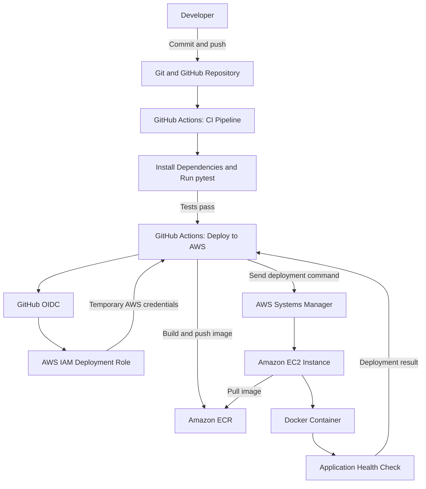

# Simple DevOps Project — Architecture

## 1. Architecture Diagram

## 2. Component Responsibilities

| Component | Responsibility |
|---|---|
| Git and GitHub | Stores application source code and version history. |
| GitHub Actions CI | Installs dependencies and runs automated tests. |
| GitHub Actions deployment | Builds and publishes the tested application's Docker image and initiates deployment. |
| GitHub OIDC | Provides a way for GitHub Actions to obtain temporary AWS credentials. |
| AWS IAM | Controls which AWS actions the deployment workflow can perform. |
| Amazon ECR | Stores Docker images for deployment. |
| AWS Systems Manager | Sends deployment commands to the EC2 instance without requiring SSH access. |
| Amazon EC2 | Hosts the Dockerized application. |
| Docker | Packages and runs the Flask application in a container. |
| Health check | Verifies whether the application responds successfully after deployment. |

## 3. Deployment Flow

1. The developer pushes a change to the GitHub repository.
2. The CI pipeline runs the automated tests.
3. If CI succeeds, the deployment workflow checks out the tested commit.
4. GitHub Actions authenticates to AWS through OIDC and the configured IAM role.
5. The workflow builds the Docker image and pushes it to Amazon ECR.
6. Systems Manager sends the deployment script to EC2.
7. EC2 pulls the image and checks the candidate container's health.
8. If the candidate passes, the deployment script replaces the running application and checks its health.
9. The workflow reports success or failure.

## 4. Security Notes

- AWS credentials are obtained through OIDC rather than stored as long-lived keys in the repository.
- The GitHub Actions IAM role should be restricted to the intended repository and branch.
- EC2 uses an IAM instance role to access ECR and Systems Manager.
- Security-group rules should allow only the network access required by the application.

## 5. Operational Note

The EC2 instance is stopped when the application is not being tested, to help reduce compute costs. Start the instance before performing a live deployment or public endpoint test.
